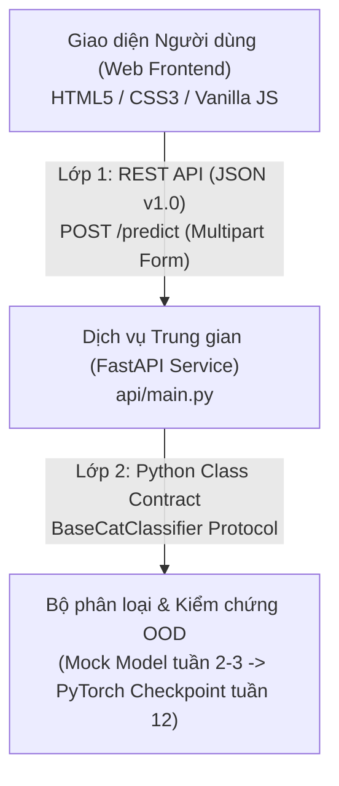

# Hợp Đồng API Mô Hình – Dịch Vụ (CatBreedID API v1.0)

> **Môn học:** Thị giác máy tính và ứng dụng (422001503102)  
> **Lớp:** DHKHMT19BTT – **Nhóm thực hiện:** Nhóm 09  
> **Phiên bản tài liệu:** `1.0.0` (Mốc Tuần 3)  
> **Mục tiêu:** Cố định giao diện lập trình giữa Mô hình CNN và Dịch vụ Web, đảm bảo khi nhóm huấn luyện bàn giao checkpoint thật ở Tuần 12, toàn bộ hệ thống giao diện và API không cần chỉnh sửa lại. Nội dung này tương ứng với bảng hợp đồng tại **Mục 2.10 của Báo cáo đồ án**.

---

## 1. Kiến Trúc Hợp Đồng Hai Lớp

Hệ thống được thiết kế theo kiến trúc phân tầng độc lập (loose coupling), gồm 2 lớp hợp đồng riêng biệt:



1. **Lớp 1: Dịch vụ ↔ Giao diện (REST API / JSON):** Định dạng dữ liệu HTTP trao đổi giữa trình duyệt web và máy chủ FastAPI.
2. **Lớp 2: Mô hình ↔ Dịch vụ (Python Abstract Interface):** Định nghĩa giao diện lập trình mà mã nguồn huấn luyện mô hình bắt buộc phải cung cấp (hàm tiền xử lý, trích xuất logits và feature vector, tính điểm OOD).

---

## 2. Lớp 1: Đặc Tả Dữ Liệu JSON v1.0 (Dịch vụ ↔ Giao diện)

### 2.1. Bảng trường dữ liệu phản hồi (`POST /predict`)

| Tên trường | Kiểu dữ liệu | Bắt buộc | Mô tả & Quy ước kỹ thuật |
| :--- | :--- | :---: | :--- |
| `api_version` | String | Có | Cố định là `"1.0"`. Dùng để kiểm tra tương thích ngược giữa client và server. |
| `status` | String | Có | Nhận một trong hai giá trị: `"accepted"` (chấp nhận In-Distribution) hoặc `"rejected"` (từ chối OOD). |
| `top_label` | String / Null | Có | Tên giống mèo có xác suất cao nhất trong 12 giống khi `status = "accepted"`. Bằng `null` khi `status = "rejected"`. |
| `top5` | Array[Object] | Có | Danh sách 5 giống mèo có xác suất cao nhất, đã được sắp xếp theo thứ tự giảm dần xác suất. |
| `top5[].label` | String | Có | Tên giống mèo trong danh mục 12 giống mục tiêu. |
| `top5[].prob` | Float | Có | Xác suất Softmax tương ứng, nằm trong đoạn $[0.0, 1.0]$. |
| `ood` | Object | Có | Kết quả của phương pháp OOD chính được cấu hình để đưa ra quyết định chấp nhận/từ chối. |
| `ood.method` | String | Có | Tên phương pháp kiểm tra (ví dụ: `"MSP"`, `"Mahalanobis"`, `"KNN"`). |
| `ood.score` | Float | Có | Điểm số đo được từ mẫu ảnh. **Quy ước: Điểm càng cao càng giống mèo In-Distribution**. |
| `ood.threshold`| Float | Có | Ngưỡng quyết định an toàn ($\tau$). |
| `ood.accept` | Boolean | Có | `true` nếu `score >= threshold` (chấp nhận), `false` nếu dưới ngưỡng (từ chối). |
| `ood_all` | Array[Object] / Null | Tùy chọn | Bảng điểm chi tiết của cả 5 phương pháp hậu kiểm OOD (dành cho Chế độ nâng cao trên giao diện). |
| `model` | Object | Có | Siêu dữ liệu mô tả phiên bản mô hình đang phục vụ. |
| `model.backbone` | String | Có | Tên kiến trúc mạng nơ-ron nền tảng (`"MobileNetV2"`, `"EfficientNet-B0"`). |
| `model.mode` | String | Có | Chế độ huấn luyện: `"feature_extractor"` (đóng băng) hoặc `"fine_tuning"`. |
| `model.seed` | Integer | Có | Hạt giống ngẫu nhiên đảm bảo tính tái lập kết quả. |
| `model.checkpoint_id` | String | Có | Mã định danh checkpoint hoặc mã băm commit Git đã huấn luyện mô hình. |
| `heatmap` | String / Null | Có | Chuỗi ảnh PNG mã hóa Base64 chứa bản đồ nhiệt Grad-CAM (dành cho Tuần 12, tạm thời là `null`). |
| `latency_ms` | Integer | Có | Thời gian trễ xử lý toàn bộ quá trình suy luận (tính bằng mili-giây). |
| `is_mock` | Boolean | Có | Cờ đánh dấu: `true` nếu kết quả từ mô hình tạm, `false` khi chạy checkpoint thật. |

---

### 2.2. Quy ước thang điểm OOD đồng nhất

Để giao diện hiển thị trực quan và so sánh công bằng giữa các thuật toán khác nhau, **toàn bộ 5 phương pháp OOD đều được chuẩn hóa về cùng một chiều**:

$$\text{Điểm số càng lớn} \implies \text{Càng gần với phân phối In-Distribution (Mèo)}$$

| Phương pháp OOD | Họ thuật toán | Công thức / Bản chất | Chiều gốc | Quy ước chuẩn hóa v1.0 | Ngưỡng tham chiếu ($\tau$) |
| :--- | :--- | :--- | :--- | :--- | :--- |
| **MSP** | Logits | $\max_c \text{Softmax}(z)_c$ | Càng cao càng tốt | Giữ nguyên $[0, 1]$ | $0.62$ |
| **MaxLogit** | Logits | $\max_c z_c$ | Càng cao càng tốt | Giữ nguyên giá trị thực | $5.1$ |
| **Energy Score** | Logits | $T \cdot \log \sum \exp(z_c / T)$ | Càng cao càng tốt | Giữ nguyên giá trị thực | $6.0$ |
| **Mahalanobis** | Features | $-(x - \mu)^T \Sigma^{-1} (x - \mu)$ | Khoảng cách càng nhỏ càng tốt | Dùng số âm ($-d_{\text{mah}}$) | $0.0$ |
| **KNN Distance** | Features | $-\|x - x_{(k)}\|_2$ | Khoảng cách càng nhỏ càng tốt | Dùng số âm ($-d_{\text{knn}}$) | $0.0$ |

---

### 2.3. Quy chuẩn mã lỗi HTTP

Dịch vụ trả về mã lỗi HTTP chuẩn mực kèm theo đối tượng JSON `{"detail": "Thông báo lỗi bằng tiếng Việt"}`:

| Mã HTTP | Tên lỗi | Trường hợp kích hoạt | Phản hồi mẫu |
| :---: | :--- | :--- | :--- |
| **`400`** | Bad Request | Dữ liệu file bị lỗi, không giải mã được pixel ảnh qua Pillow | `{"detail": "Không đọc được ảnh. Hãy thử ảnh khác."}` |
| **`413`** | Payload Too Large | Dung lượng file tải lên vượt quá giới hạn **8 MB** | `{"detail": "Ảnh quá lớn (tối đa 8 MB)."}` |
| **`415`** | Unsupported Media Type | Định dạng Content-Type không nằm trong `{image/jpeg, image/png}` | `{"detail": "Chỉ chấp nhận ảnh JPG hoặc PNG."}` |

---

## 3. Lớp 2: Giao Diện Lập Trình Phía Mô Hình (`BaseCatClassifier`)

Mã nguồn mô hình (do bạn Hậu/Khôi/Tài xây dựng) khi tích hợp vào dịch vụ phải kế thừa và triển khai lớp trừu tượng `BaseCatClassifier` trong `api/temp_model.py`:

```python
from abc import ABC, abstractmethod
from typing import Any, Dict, List, Optional, Tuple
import numpy as np
from PIL import Image

class BaseCatClassifier(ABC):
    """Hợp đồng giao diện bắt buộc cho tất cả các mô hình triển khai."""

    def __init__(self, classes: Optional[List[str]] = None, msp_threshold: float = 0.50):
        self.classes = classes  # Danh sách 12 giống mèo theo thứ tự cố định
        self.msp_threshold = msp_threshold

    @abstractmethod
    def preprocess(self, img: Image.Image) -> Any:
        """Chuẩn hóa ảnh đầu vào: Resize 256 cạnh ngắn, CenterCrop 224x224 và chuẩn hóa ImageNet."""
        pass

    @abstractmethod
    def predict_raw(self, img: Image.Image) -> Tuple[np.ndarray, np.ndarray]:
        """Trích xuất đồng thời cả Logits và Feature vector trước lớp phân loại fully-connected.
        
        Returns:
            - logits: mảng np.ndarray shape (12,) cho các phương pháp MSP, MaxLogit, Energy.
            - features: mảng np.ndarray shape (D,) cho các phương pháp Mahalanobis, KNN.
        """
        pass

    @abstractmethod
    def predict(self, img: Image.Image) -> Dict[str, Any]:
        """Trả về toàn bộ kết quả phân loại, top 5 và điểm OOD khớp với schema JSON v1.0."""
        pass
```

---

## 4. Đặc Tả "Gói Mô Hình Triển Khai" (Model Deployment Package)

Đây là **danh mục bàn giao chính thức ở Tuần 12** từ người phụ trách mô hình cho người phụ trách dịch vụ Web. Gói mô hình phải được đặt trong thư mục `model_package/` với cấu trúc chuẩn sau:

```text
model_package/
├── weights.onnx / model.pth        # File trọng số mạng nơ-ron đã huấn luyện hoàn chỉnh
├── classes.json                    # Danh sách 12 nhãn giống mèo đúng thứ tự index [0..11]
├── preprocess.json                 # Tham số chuẩn hóa: input_size (224), mean, std
├── ood_config.json                 # Ngưỡng quyết định tau và nhiệt độ T của cả 5 phương pháp
├── feature_stats.npz               # Vector tâm cụm mu và ma trận hiệp biến Sigma^-1 (cho Mahalanobis & KNN)
└── meta.json                       # Siêu dữ liệu: backbone, seed, commit hash, ngày xuất bản
```

### Chi tiết các file cấu hình mẫu:

#### `classes.json`
```json
[
  "Abyssinian", "Bengal", "Birman", "Bombay", "British Shorthair", "Egyptian Mau",
  "Maine Coon", "Persian", "Ragdoll", "Russian Blue", "Siamese", "Sphynx"
]
```

#### `ood_config.json`
```json
{
  "msp": { "threshold": 0.62 },
  "max_logit": { "threshold": 5.1 },
  "energy": { "threshold": 6.0, "temperature": 1.0 },
  "mahalanobis": { "threshold": 0.0 },
  "knn": { "threshold": 0.0, "k": 10 }
}
```

---

## 5. Ví Dụ Request & Response Thực Tế

### 5.1. Ví dụ Lệnh `curl` gọi dịch vụ
```bash
curl -X POST "http://127.0.0.1:8000/predict" \
     -H "accept: application/json" \
     -H "Content-Type: multipart/form-data" \
     -F "file=@img/Abyssinian_1.jpg;type=image/jpeg"
```

### 5.2. Phản hồi trường hợp Chấp nhận (`accepted` - Ảnh mèo In-Distribution)
```json
{
  "api_version": "1.0",
  "is_mock": true,
  "status": "accepted",
  "top_label": "Abyssinian",
  "top5": [
    { "label": "Abyssinian", "prob": 0.9412 },
    { "label": "Bengal", "prob": 0.0245 },
    { "label": "Egyptian Mau", "prob": 0.0152 },
    { "label": "Siamese", "prob": 0.0101 },
    { "label": "Birman", "prob": 0.0090 }
  ],
  "ood": {
    "method": "MSP (tạm)",
    "score": 0.9412,
    "threshold": 0.5,
    "accept": true
  },
  "ood_all": [
    { "method": "MSP (tạm)", "score": 0.9412, "threshold": 0.5, "accept": true },
    { "method": "MaxLogit", "score": 8.8, "threshold": 5.1, "accept": true },
    { "method": "Energy Score", "score": 9.5, "threshold": 6.0, "accept": true },
    { "method": "Mahalanobis (Feature space)", "score": 1.32, "threshold": 0.0, "accept": true },
    { "method": "KNN Distance (k=10)", "score": 0.68, "threshold": 0.0, "accept": true }
  ],
  "model": {
    "backbone": "MobileNetV2 (mock)",
    "mode": "feature_extractor",
    "seed": 1403248817,
    "checkpoint_id": "mock-checkpoint-v1.0"
  },
  "heatmap": null,
  "latency_ms": 32
}
```

### 5.3. Phản hồi trường hợp Từ chối (`rejected` - Ảnh ngoài phân bố OOD)
```json
{
  "api_version": "1.0",
  "is_mock": true,
  "status": "rejected",
  "top_label": null,
  "top5": [
    { "label": "Ragdoll", "prob": 0.2810 },
    { "label": "Birman", "prob": 0.2430 },
    { "label": "Persian", "prob": 0.1820 },
    { "label": "Maine Coon", "prob": 0.1140 },
    { "label": "Sphynx", "prob": 0.0800 }
  ],
  "ood": {
    "method": "MSP (tạm)",
    "score": 0.2810,
    "threshold": 0.5,
    "accept": false
  },
  "ood_all": [
    { "method": "MSP (tạm)", "score": 0.281, "threshold": 0.5, "accept": false },
    { "method": "MaxLogit", "score": 3.2, "threshold": 5.1, "accept": false },
    { "method": "Energy Score", "score": 4.1, "threshold": 6.0, "accept": false },
    { "method": "Mahalanobis (Feature space)", "score": -0.66, "threshold": 0.0, "accept": false },
    { "method": "KNN Distance (k=10)", "score": -0.64, "threshold": 0.0, "accept": false }
  ],
  "model": {
    "backbone": "MobileNetV2 (mock)",
    "mode": "feature_extractor",
    "seed": 2849182390,
    "checkpoint_id": "mock-checkpoint-v1.0"
  },
  "heatmap": null,
  "latency_ms": 28
}
```

---

## 6. Hướng Dẫn Chạy & Kiểm Thử Hợp Đồng

### 6.1. Khởi động dịch vụ
```bash
uvicorn api.main:app --reload --port 8000
```
- Truy cập Swagger UI tương tác trực tiếp: [http://127.0.0.1:8000/docs](http://127.0.0.1:8000/docs)
- Kiểm tra trạng thái dịch vụ: [http://127.0.0.1:8000/health](http://127.0.0.1:8000/health)

### 6.2. Chạy bài kiểm thử hợp đồng tự động
Bộ kiểm thử gồm 6 bài test tự động xác nhận tính toàn vẹn của dữ liệu:
```bash
python -m unittest api/test_contract.py
```
*(Yêu cầu kết quả: 6 bài test `OK` hoàn toàn).*
